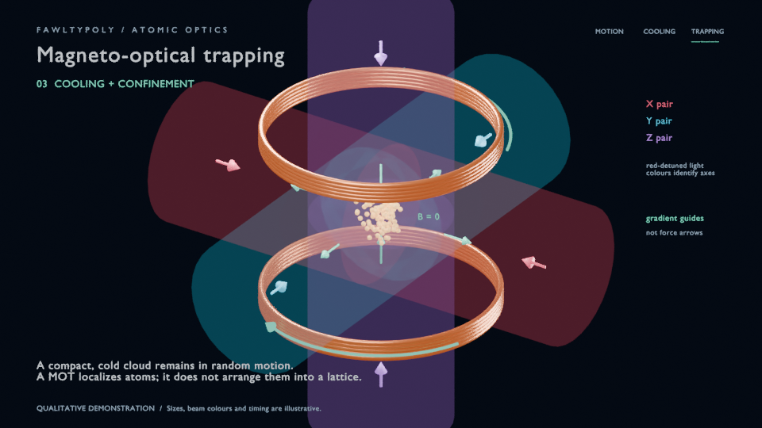

# Magneto-optical trap (MOT) project

A qualitative educational **Blender animation**, built with FawltyPoly and
rendered in Cycles. This folder contains the source, portable render commands,
a ready-to-open scene, and a preview for continuing on another computer.



## Handoff status — 22 November 2026

- The animation and library extensions are implemented and tested.
- `assets/mot.blend` contains the complete **480-frame, 24 fps, 20-second** animation.
  It plays without Python dependencies, Basilisp, drivers or frame handlers.
- `assets/preview.mp4` is a completed **640×360, 6 fps Cycles preview**.
- The requested higher-quality 24 fps render was **cancelled at the user's request**.
  No completed higher-quality MP4 exists yet. Rendering is not running.
- Agreed next render size: **1280×720**, not 1920×1080. The last selected quality
  was 128 maximum samples, adaptive threshold 0.02, minimum 16 samples, denoising.
- The original CPU-only machine took about 11–12 seconds/frame at these settings.
  The portable renderer automatically uses a supported GPU when available.
- Partial frames from the cancelled run remain on the original machine; they are
  not committed. Start a fresh render on the next machine.

## Continue on another computer

If transferring the supplied Git bundle rather than fetching from the remote:

```sh
git clone --branch codex/mot-project /path/to/mot-project.bundle fawltypoly
cd fawltypoly
# Optional: restore the normal upstream remote after cloning the bundle.
git remote set-url origin git@github.com:light-matters/fawltypoly.git
```

Use Blender **5.3 or newer** for the committed scene (created with 5.3).
All commands below assume the repository root as the current directory.
No Python packages are needed to render the committed `.blend`.

```sh
# Check the scene without starting a render.
blender --background projects/mot/assets/mot.blend --python-exit-code 1 \
  --python projects/mot/verify.py

# Inspect the renderer's device selection and settings, without rendering.
blender --background projects/mot/assets/mot.blend --python-exit-code 1 \
  --python projects/mot/render.py -- --device auto --dry-run

# Render every frame in Cycles. Auto prefers a supported GPU, falling back to CPU.
blender --background projects/mot/assets/mot.blend --python-exit-code 1 \
  --python projects/mot/render.py -- --device auto

# Once all 480 frames are present, encode the MP4 (requires FFmpeg + ffprobe).
python3 projects/mot/encode.py
```

Defaults: `output/frames/frame-0001.png` through `frame-0480.png`, followed by
`output/mot-24fps.mp4`. Paths are relative to this project folder, independent of
where the repository is located. Generated output is ignored by Git.

Rerun the same render command to resume: complete PNGs are validated and skipped;
frames are written to a temporary name and renamed only when complete. Scene
hash and render settings are recorded in `output/frames/settings.json`; mismatched
settings require a different output directory to avoid mixing renders.

Options after Blender's `--` include `--device CPU|OPTIX|CUDA|HIP|ONEAPI|auto`,
`--samples 64`, `--width 1280`, `--start 1`, `--end 480`, and `--output PATH`.
For example, a quick one-frame check in a separate folder:

```sh
blender --background projects/mot/assets/mot.blend --python-exit-code 1 \
  --python projects/mot/render.py -- --start 224 --end 224 --samples 4 \
  --width 640 --output projects/mot/output/check
```

Encoder overrides: `--frames PATH --output PATH`. It requires all 480 valid PNGs
and checks the encoded video's resolution, frame count, duration, and 24 fps rate.
It refuses to overwrite an existing MP4; choose a different output filename.

Alternatively open `assets/mot.blend` in Blender and render normally. The scene
already uses Cycles, 720p, 24 fps and frame step 1. Enable the appropriate GPU in
Blender preferences if using the UI. Scrub to frame 1; the file opens on the
localized final cloud. Timeline markers identify all stages.

## Source and package structure

| Path / API | Responsibility |
| --- | --- |
| `fawltypoly.api.v1` | General geometry/surfaces, materials, scenes, mesh instances and baked animation |
| `fawltypoly.quantum-optics.api.v1` | Atom-cloud descriptions, cooling beams, anti-Helmholtz coils, quadrupole guides and AMPS adapters |
| `projects/mot/scene.lpy` | MOT apparatus, presentation colours, atom instancing and animation orchestration |
| `projects/mot/motion.py` | Pure, deterministic authored trajectories; no dynamics solver |
| `projects/mot/build.py` | Source generation, camera, captions, current cues, lighting and Cycles setup |
| `projects/mot/render.py` | Portable, resumable rendering of the saved scene |
| `projects/mot/encode.py` | Complete-frame validation and MP4 encoding |
| `projects/mot/verify.py` | Standalone scene verification inside Blender |

The general API stays independent of atom-specific objects. The domain API
composes the general geometry layer and returns ordinary scene-description data.
Legacy general-API AMPS exports remain available for compatibility.
See [the API contract](../../docs/API.md) for details.

## Regenerate from source

Only scene generation needs Basilisp. Use Python with the same major/minor
version as Blender; `build.py` verifies the match. For example:

```sh
python -m venv .venv
.venv/bin/python -m pip install basilisp==0.5.1 basilisp-blender==0.5.0 matplotlib
.venv/bin/python projects/mot/build.py --stills 72 224 420
```

Default generation output: `projects/mot/output/mot.blend` and the requested
stills alongside it. The builder launches a separate factory-startup Blender and
does not change an open project. It replaces its selected output files on rerun.
Additional options: `--atoms`, `--seed`, `--fps`, `--width`, `--samples`,
`--render-animation`, `--frame-step`, `--output`. Duration remains 20 seconds.
Build at the default 24 fps for compatibility with the portable renderer/encoder.
The committed asset is set to 720p/128 samples; builder defaults are 1280-wide/32.

In Blender's Basilisp REPL, generate only the apparatus and baked atom paths:

```clojure
(require '[projects.mot.scene :as mot])
(mot/show! {:atom-count 144 :seed 17 :frames 480})
```

`show!` preserves object identity on re-evaluation and replaces atom location
tracks. The standalone builder adds apparatus activation, captions, camera and
lighting. Atom meshes are shared; each atom retains independent motion.

## Storyboard and educational assumptions

| Seconds | Action |
| --- | --- |
| 0–4 | Rapid irregular motion, emphasized by velocity strokes |
| 4–5 | Six cooling beams appear as opposing pairs along X, Y and Z |
| 5–11 | Central atoms slow without contracting to a point |
| 11–12 | Coils activate, opposite-current cues and quadrupole guides appear |
| 12–16 | The cooled population contracts; untrapped atoms depart |
| 16–20 | A localized, disordered cloud retains small random-looking motions |

This is an illustration, not a physical simulation. Seeded trigonometric paths
are retimed for cooling and eased into randomly scattered destinations. The
central population stays within the common overlap of the three beam cylinders;
outer paths pass outside that overlap. Capture fraction, atom sizes and timing
are presentation choices. Beam colours identify axes, not optical frequencies.
Transparent emissive envelopes show the illuminated region without modelling
light scattering in vacuum. Six arrows show counter-propagating light directions.
Polarization, repumping, level structure and quantitative temperature are omitted.

The magnetic guides indicate a quadrupole field proportional to `[x,y,-2z]`, with
zero at the centre; they are not inward force arrows. Light and the magnetic
gradient jointly provide MOT confinement. The final cloud is disordered, not a
lattice, and atoms retain motion.

## Verification and known limitation

```sh
.venv/bin/python -m unittest tests/test_mot_motion.py
.venv/bin/python tests/run_blender.py --suite animation
.venv/bin/python tests/run_blender.py --suite demos
```

The new checks cover reproducibility, continuity, overlap, escape, slowing,
contraction, mesh sharing, shared-action isolation, track replacement, emissive
material reset, closed cylinders, apparatus descriptions and repeatable scenes.
Standalone playback/scrubbing and the preview renders have also been checked.

The full integration suite has one **pre-existing** failure in `field-frames`:
the `1e-320` vector becomes zero under this Blender 5.3 runtime. This failure was
confirmed against the unchanged original repository; it is unrelated to the MOT.
